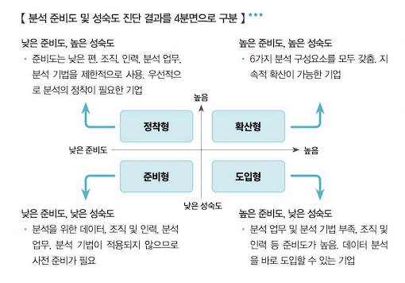

# 분석 마스터플랜

## Table of Contents

[마스터플랜 수립](#마스터플랜-수립)

[데이터 조직 및 인력방안 수립](#데이터-조직-및-인력방안-수립)

---

## 마스터플랜 수립

### 분석 마스터플랜 개념

분석 마스터플랜이란 분석 프로젝트를 위한 전체 설계도와 같다.

분석 방법론과 과제발굴 수행과정 전체를 포함하는 광범위한 개념이다.

### 분석 마스터플랜 수립 프레임워크

**`1. 적용 우선순위, 범위 및 방식 결정`**

전략적 중요도, 비즈니스 성과 및 ROI, 실행 용이성을 기준으로 분석 과제의 우선순위를 설정한다.

분석 과제를 업무에 내재화 할 것인지 여부, 분석 데이터를 내부의 데이터로 한정할 것인지, 또는 외부의 데이터까지 포함할 것인지, 그리고 기술의 적용 수준까지의 설정을 포함한다.

**`2. 분석 구현의 로드맵 수립`**

분석 과제의 우선 순위와 적용 범위 및 방식을 종합적으로 고려하여 최종적으로 분석 구현의 로드맵을 수립한다.

### 수행 과제 도출 및 우선순위 평가

| 요소          | 설명                                                                                 |
| ------------- | ------------------------------------------------------------------------------------ |
| 전략적 중요도 | 해당 과제가 조직의 전략적 목표 달성에 얼마나 기여하는지를 평가하는, 시급성 판단 기준 |
| 실행 용이성   | 데이터 획득·저장·가공 비용과 분석 적용 비용 등을 고려한, 과제 수행 난이도 판단 기준  |
| ROI 요소      | 투자 대비 효과(비즈니스 성과)를 의미하며, 시급성 판단의 또 다른 기준이 됨            |

**`ROI(Return On Investment) 요소`**

빅데이터의 특징인 4V를 ROI 관점으로 살펴보면 다음과 같다.

| 요소       | 4V 요소                   |
| ---------- | ------------------------- |
| Investment | Volume, Variety, Velocity |
| Return     | Value                     |

**`ROI를 활용한 우선순위 평가 기준`**

| 평가 기준 | 설명                                         |
| --------- | -------------------------------------------- |
| 시급성    | 전략적 중요도, KPI를 고려한 시급성 여부 판단 |
| 난이도    | 분석 수준, 분석 비용, 분석 적합성 여부 판단  |

**`포트폴리오 사분면(Quadrant) 분석을 활용한 우선순위 평가 기준`**

우선순위 평가 기준을 시급성에 둔다면 **3 &rarr; 1 &rarr; 4 &rarr; 2** 순으로 평가하고, 기준을 난이도에 둔다면 **3 &rarr; 4 &rarr; 1 &rarr; 2** 로 한다.

---

## 분석 거버넌스 체계 수립

### 분석 거버넌스 체계

분석 거버넌스(Governance)는 기업에서 의사결정을 위한 데이터의 분석과 활용을 위한 체계적인 관리를 의미한다.

단순히 데이터를 수집, 축적하는 측면을 넘어서 데이터 분석을 기업의 문화로 정착시키고 데이터 분석을 지속적으로 고도화하기 위해 데이터 관리 체계를 수립하는 것이다.

### 데이터 분석 성숙도 모델 및 수준 진단

기업들은 데이터 분석의 도입 여부와 활용 여부에 대한 명확한 분석 수준을 점검할 필요가 있다.

분석 준비도와 성숙도를 통하여 분석 수준을 진단하여 분석 유형 및 방향성을 결정한다.

**`분석 준비도`**

| 진단 영역         | 설명                                                                                      |
| ----------------- | ----------------------------------------------------------------------------------------- |
| 분석 업무 파악    | 발생한 사실 분석, 예측 분석, 시뮬레이션 분석, 최적화 분석 등 업무별 분석 수행 여부를 진단 |
| 분석 인력 및 조직 | 분석 전문가 직무의 존재 여부, 관리자의 기본 분석 역량, 교육훈련 프로그램 등을 진단        |
| 분석 기법         | 업무별 적합한 분석 기법과 도입 방법론, 분석기법 라이브러리 구축 여부 등을 진단            |
| 분석 데이터       | 분석 업무에 필요한 데이터의 충분성, 신뢰성, 적시성을 진단                                 |
| 분석 문화         | 사실에 근거한 의사결정 문화, 관리자의 데이터 중시 여부 등을 진단                          |
| IT 인프라         | 데이터 웨어하우스·데이터마트, 통계 분석 환경, EAI/ETL 등 데이터 유통체계를 진단           |

**`분석 성숙도`**

CMMI(Capability Maturity Model Integration) 모델을 활용하여 조직의 성숙도를 평가한다.

| 단계   | 내용                                             | 비즈니스 부문                        | 조직, 역량 부문                                   | IT 부문                                                     |
| ------ | ------------------------------------------------ | ------------------------------------ | ------------------------------------------------- | ----------------------------------------------------------- |
| 도입   | 분석 환경과 시스템을 구축하는 단계               | 실적 분석 및 통계, 정기 보고 수행    | 일부 부서에서 담당자의 역량에 의존해 수행         | DW/DM, OLAP, ETL/EAI, 분석 전용 서버 구축                   |
| 활용   | 분석 결과를 실제 업무에 적용하는 단계            | 미래 결과 예측, 시뮬레이션           | 전문 담당 부서에서 분석 기법을 도입해 수행        | 실시간 대시보드, 통계 분석 환경, 시각화 구축                |
| 확산   | 전사 차원에서 분석을 관리하고 공유하는 단계      | 전사 성과 실시간 분석, 프로세스 혁신 | 전사 모든 부서가 수행하며 분석 전담조직(COE) 운영 | 빅데이터 관리 환경, 시뮬레이션·최적화 등 빅데이터 분석 환경 |
| 최적화 | 분석을 진화시켜 혁신과 성과 향상에 기여하는 단계 | 외부환경 분석 활용, 최적화 업무 적용 | 경영진이 분석을 활용하며 전략과 연계              | 분석 협업환경, 분석 샌드박스, 프로세스 내재화               |

**`분석 수준 진단 결과`**

분석 준비도 및 성숙도 진단 결과를 4분면으로 구분하여 유형을 구분한다.

| 준비도 | 성숙도 | 유형   | 특징                                                                                                 |
| ------ | ------ | ------ | ---------------------------------------------------------------------------------------------------- |
| 낮음   | 낮음   | 준비형 | 데이터, 인력, 조직, 분석 업무 및 기법 등이 갖춰져 있지 않아 사전 준비가 필요한 기업                  |
| 낮음   | 높음   | 정착형 | 준비도는 낮으나 조직·인력·분석 업무 및 기법을 제한적으로 사용하고 있어 1차적인 정착이 필요한 기업    |
| 높음   | 낮음   | 도입형 | 활용하는 분석 업무 및 기법은 부족하지만 적용 조직 등 준비도가 높아 바로 도입이 가능한 기업           |
| 높음   | 높음   | 확산형 | 필요한 6가지 분석 구성요소를 모두 갖추고 있으며 현재 부분적으로 도입되어 지속적인 확산이 필요한 기업 |

---

## 데이터 조직 및 인력방안 수립

### 데이터 분석 조직

분석 조직은 비즈니스 질문에 부합하는 가치를 찾고 비즈니스를 최적화하는 것을 목표로 한다.

| 구분 | 설명                                                                                                                                        |
| ---- | ------------------------------------------------------------------------------------------------------------------------------------------- |
| 목표 | 회사의 경쟁력 확보를 위한 분석 과제를 지속적으로 발굴하고 수행하여, 과거 실적 위주의 리포팅에서 나아가 실질적인 비즈니스 가치를 창출하는 것 |
| 역할 | 전사 차원의 분석 업무를 총괄하며, 우수한 분석 자원(인력·기법·데이터)을 발굴·육성하여 조직 내 데이터 기반 의사결정 문화를 확산시키는 것      |
| 구성 | 데이터 사이언티스트, 비즈니스 분석가, 데이터 엔지니어 등 서로 다른 전문성을 가진 인력이 유기적으로 협업하는 형태로 구성                     |

### 데이터 분석 조직 유형

| 구분                  | 특징                                                                                                                                                                                                                      |
| --------------------- | ------------------------------------------------------------------------------------------------------------------------------------------------------------------------------------------------------------------------- |
| 집중형 조직 구조      | 전사 분석업무를 별도의 분석 전담 조직에서 담당. 전략적 중요도에 따라 우선순위를 정해 신속하게 추진할 수 있으나, 현업 업무 부서와 분석 조직 간 업무가 이중화·이원화될 가능성이 있음                                        |
| 기능 중심의 조직 구조 | 별도의 분석 전담 조직 없이 각 현업 부서에서 직접 분석 업무를 수행. 전사 차원의 핵심 분석 과제 수행이 어렵고, 과거 실적에 국한된 분석에 그칠 가능성이 높음                                                                 |
| 분산형 조직 구조      | 분석 전담 조직 소속 인력을 현업 부서에 배치하여 분석 업무를 수행. 전사 차원의 우선순위를 반영하면서도 분석 결과에 따른 신속한 Action이 가능하나, 현업 부서 업무와 분석 업무 간 역할 분담을 명확히 해야 함(중복 업무 방지) |

### 분석 과제 관리

분석 과제가 성공적으로 수행되었다면 지속적인 분석 니즈 및 기회가 분석 과제 형태로 도출될 수 있다.

**`분석 과제 관리 프로세스`**

프로세스는 크게 과제 발굴과 과제 수행으로 구분된다.

| 프로세스       | 설명                                                       |
| -------------- | ---------------------------------------------------------- |
| 과제 발굴 단계 | 과제를 발굴하고 **POOL** 로 관리하고 분석 과제를 선정한다. |
| 과제 수행 단계 | 팀을 구성하고 분석 과제를 수행                             |

수행이 완료된 과제와 그 결과물은 다시 **POOL**로 축적되어 향후 신규 과제 발굴 및 우선순위 조정에 활용되며, 이 과정이 반복됨에 따라 조직의 분석 수준과 분석 문화가 지속적으로 고도화된다.
