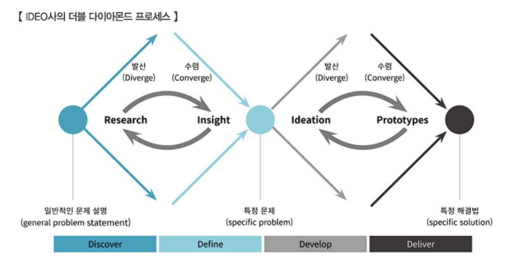
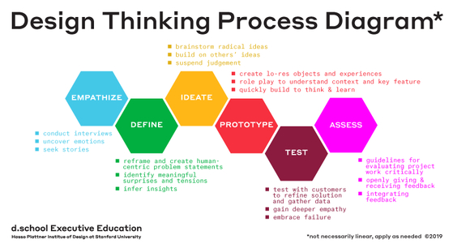

# 데이터 분석 기획의 이해

## Table of Contents

[분석 기획 방향성 도출](#분석-기획-방향성-도출)

---

## 분석 기획 방향성 도출

### 분석 대상과 방법에 따른 4가지 분석 주제

| How / What | Known        | Unknown   |
| ---------- | ------------ | --------- |
| Known      | Optimization | Insight   |
| Unknown    | Solution     | Discovery |

- 최적화(Optimization): 분석 대상과 방법을 모두 알고 있는 경우

- 해결책(Solution): 분석 대상은 알지만 방법을 모르는 경우

- 통찰력(Insight): 분석 대상은 모르지만 방법을 아는 경우

- 발견(Discovery): 분석 대상과 방법 모두 모르는 경우

### 목표 시점별 분석 기획

| 구분                  | 목적                             | 목표                                  | 과제 유형   | 접근 방식                                                                   |
| --------------------- | -------------------------------- | ------------------------------------- | ----------- | --------------------------------------------------------------------------- |
| 과제 중심적 접근 방식 | 당면한 분석 과제를 신속히 해결   | Quick-Win, 명확한 해결책 도출         | 일회성 과제 | 문제가 발생한 시점에 필요한 데이터를 수집해 대응하는 상향식(Bottom-up) 접근 |
| 마스터 플랜 방식      | 지속적인 분석 문화를 조직에 정착 | 전사적 관점의 장기적 분석 로드맵 수립 | 지속적 과제 | 전체 계획 하에 여러 과제를 체계적으로 도출·수행하는 하향식(Top-down) 접근   |

### 분석 기획시 고려 사항

| 사항                               | 설명                                                                                     |
| ---------------------------------- | ---------------------------------------------------------------------------------------- |
| 가용 데이터 고려                   | 분석에 필요한 데이터의 유형(정형/비정형)과 확보 가능성을 사전에 파악해야 함              |
| 적절한 활용 방안과 유스케이스 탐색 | 유사한 분석 사례(유스케이스)를 탐색하여 최적의 분석 방안과 활용 방향을 모색해야 함       |
| 장애요소에 대한 사전 계획          | 분석 수행 과정에서 발생할 수 있는 조직 내 장애 요소를 사전에 파악하고 대응을 계획해야 함 |

---

## 분석 방법론

### 분석 방법론 구성요소

| 구성 요소                            | 설명                                                      |
| ------------------------------------ | --------------------------------------------------------- |
| 상세한 절차(Procedure)               | 프로세스를 구성하는 세부 절차와 활동, 흐름을 정의함       |
| 방법(Methods)                        | 절차 내 각 활동을 수행하기 위한 구체적인 방법을 제시함    |
| 도구와 기법(Tools & Techniques)      | 분석 과정에서 필요한 기법과 소프트웨어 등의 도구를 제공함 |
| 템플릿과 산출물(Templates & Outputs) | 각 단계에서 도출되는 결과물의 양식과 작성 사례를 제공함   |

**`기업의 합리적 의사결정 방해요소`**

고정 관념 / 편향된 생각

- 기존의 경험이나 지식의 틀에 얽매여 새로운 정보를 객관적으로 받아들이지 못하는 현상.

프레이밍(framing) 효과

- 동일한 사건이나 상황을 두고도 문제가 제시되는 틀(방식)에 따라 개인의 판단이나 선택이 달라질 수 있는 현상.

### 분석 방법론 적용 모델

| 종류                 | 설명                                                                                             |
| -------------------- | ------------------------------------------------------------------------------------------------ |
| 폭포수 모델          | 이전 단계가 완료되어야 다음 단계로 진행할 수 있는 순차적·하향식 모델                             |
| 프로토타입 모델      | 사용자 요구사항을 정확히 파악하기 위해 시제품을 만들고 피드백을 받아 점진적으로 개선하는 모델    |
| 나선형 모델          | 폭포수 모델과 프로토타입 모델의 장점을 결합해, 위험을 최소화하며 개발을 반복(Iteration)하는 모델 |
| 계층적 프로세스 모델 | 최상위 단계(Phase)-중간 단계(Task)-최하위 단계(Step)의 계층 구조로 세분화된 절차를 제공하는 모델 |

### 전통적인 분석 방법론

**`KDD(Knowledge Discovery in Database) 분석 방법론`**

데이터로부터 통계적 패턴이나 지식을 찾기 위해 체계적으로 정리한 데이터 마이닝 프로세스.

| 프로세스                     | 설명                                                                              |
| ---------------------------- | --------------------------------------------------------------------------------- |
| 데이터셋 선택(Selection)     | 분석 목적에 맞는 대상 데이터를 원본 데이터로부터 선택하는 단계                    |
| 데이터 전처리(Preprocessing) | 잡음, 이상치, 결측치 등을 제거하여 데이터를 정제하는 단계                         |
| 데이터 변환(Transformation)  | 분석 목적에 맞게 변수를 변환하거나 차원을 축소하는 등 데이터를 가공하는 단계      |
| 데이터 마이닝(Data Mining)   | 변환된 데이터에 적절한 분석 기법(알고리즘)을 적용해 패턴이나 모델을 도출하는 단계 |
| 해석과 평가(Evaluation)      | 도출된 패턴·모델을 해석하고 그 의미와 유용성을 평가하는 단계                      |

**`CRISP-DM(Cross Industry Standard Process for Data Mining) 분석 방법론`**

1999년 유럽연합에서 발표된 계층적 프로세스 모델. KDD보다 세분화 되어있다.

| 프로세스    | 설명                                                                   |
| ----------- | ---------------------------------------------------------------------- |
| 업무 이해   | 분석을 수행하는 목적과 비즈니스 문제를 파악하는 단계                   |
| 데이터 이해 | 분석에 필요한 데이터를 수집하고 데이터의 속성과 품질을 탐색하는 단계   |
| 데이터 준비 | 분석 대상 데이터를 선택·정제·통합해 분석에 적합한 형태로 가공하는 단계 |
| 모델링      | 다양한 분석 기법을 선택해 모델을 구축하고 파라미터를 최적화하는 단계   |
| 평가        | 구축된 모델이 비즈니스 목적에 부합하고 신뢰할 수 있는지 평가하는 단계  |
| 전개        | 검증된 모델을 실제 업무 환경에 적용하고 운영하는 단계                  |

### 빅데이터 분석 방법론 계층적 프로세스 5단계

**`Phase 1 - 분석 기획`**

| Task                       | Step                                               |
| -------------------------- | -------------------------------------------------- |
| 비즈니스 이해 및 범위 설정 | 비즈니스 이해, 프로젝트 범위 설정                  |
| 프로젝트 정의 및 계획 수립 | 데이터 분석 프로젝트 정의, 프로젝트 수행 계획 수립 |
| 프로젝트 위험 계획 수립    | 데이터 분석 위험 식별, 위험 대응 계획 수립         |

**`Phase 2 - 데이터 준비`**

| Task                       | Step                                               |
| -------------------------- | -------------------------------------------------- |
| 필요 데이터 정의           | 데이터 정의, 데이터 획득 방안 수립                 |
| 데이터 스토어 설계         | 정형 데이터 스토어 설계, 비정형 데이터 스토어 설계 |
| 데이터 수집 및 정합성 검정 | 데이터 수집 및 저장, 데이터 정합성 점검            |

**`Phase 3 - 데이터 분석`**

| Task               | Step                                                    |
| ------------------ | ------------------------------------------------------- |
| 분석용 데이터 준비 | 비즈니스 룰 확인, 분석용 데이터셋 준비                  |
| 텍스트 분석        | 텍스트 데이터 확인 및 추출, 텍스트 데이터 분석          |
| 탐색적 분석        | 탐색적 데이터 분석(EDA), 데이터 시각화                  |
| 모델링             | 데이터 분할, 데이터 모델링, 모델 적용 및 운영 방안 수립 |
| 모델 평가 및 검증  | 모델 평가, 모델 검증                                    |

**`Phase 4 - 시스템 구현`**

| Task                  | Step                             |
| --------------------- | -------------------------------- |
| 설계 및 구현          | 시스템 분석 및 설계, 시스템 구현 |
| 시스템 테스트 및 운영 | 시스템 테스트, 시스템 운영 계획  |

**`Phase 5 - 평가 및 전개`**

| Task                  | Step                              |
| --------------------- | --------------------------------- |
| 모델 발전 계획        | 모델 발전 계획 수립               |
| 프로젝트 평가 및 보고 | 프로젝트 성과 평가, 프로젝트 종료 |

---

## 분석 과제 발굴

### 분석 과제 탐색 방법

| 방법                     | 설명                                                                                                                     |
| ------------------------ | ------------------------------------------------------------------------------------------------------------------------ |
| 하향식 접근법(Top-Down)  | 해결해야 할 문제가 정해져 있을 때, 그 문제를 논리적으로 세분화하여 필요한 데이터와 분석 방법을 체계적으로 도출하는 방식  |
| 상향식 접근법(Bottom-Up) | 문제 정의 자체가 어려운 경우, 다양한 데이터를 기반으로 문제를 탐색·재정의하고 시행착오를 통해 해결책을 개선해나가는 방식 |

### 상향식 접근법 - 디자인 씽킹

**`IDEO사의 디자인 씽킹`**

더블 다이아몬드 프로세스라고 불린다.

상향식 접근법의 발산 단계와 하향식 접근법의 수렴 단계가 반복적으로 수행되어 창의적인 아이디어를 도출하는 방식이다.

**`d.school의 디자인 씽킹`**

공감(Empathize) -> 문제 정의(Define) -> 아이디어 도출(Ideate) -> 프로토타입(Prototype) -> 테스트(Test)의 5단계로 구성된다.

사용자에 대한 공감을 바탕으로 문제를 정의하고, 다양한 아이디어를 도출하여 프로토타입을 제작한 뒤, 사용자 테스트를 통해 피드백을 반영하며 반복적으로 개선해 나가는 방식이다.
