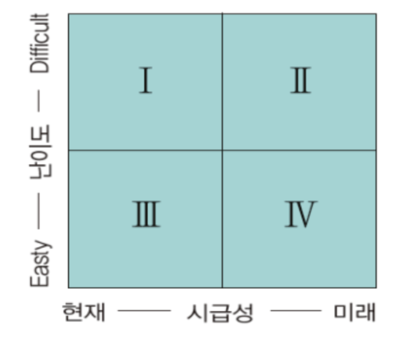

# 분석 마스터플랜

## Table of Contents

[마스터플랜 수립](#마스터플랜-수립)

---

## 마스터플랜 수립

### 분석 마스터플랜 개념

분석 마스터플랜이란 분석 프로젝트를 위한 전체 설계도와 같다.

분석 방법론과 과제발굴 수행과정 전체를 포함하는 광범위한 개념이다.

### 분석 마스터플랜 수립 프레임워크

**`1. 적용 우선순위, 범위 및 방식 결정`**

전략적 중요도, 비즈니스 성과 및 ROI, 실행 용이성을 기준으로 분석 과제의 우선순위를 설정한다.

분석 과제를 업무에 내재화 할 것인지 여부, 분석 데이터를 내부의 데이터로 한정할 것인지, 또는 외부의 데이터까지 포함할 것인지, 그리고 기술의 적용 수준까지의 설정을 포함한다.

**`2. 분석 구현의 로드맵 수립`**

분석 과제의 우선 순위와 적용 범위 및 방식을 종합적으로 고려하여 최종적으로 분석 구현의 로드맵을 수립한다.

### 수행 과제 도출 및 우선순위 평가

| 요소          | 설명                                                                                 |
| ------------- | ------------------------------------------------------------------------------------ |
| 전략적 중요도 | 해당 과제가 조직의 전략적 목표 달성에 얼마나 기여하는지를 평가하는, 시급성 판단 기준 |
| 실행 용이성   | 데이터 획득·저장·가공 비용과 분석 적용 비용 등을 고려한, 과제 수행 난이도 판단 기준  |
| ROI 요소      | 투자 대비 효과(비즈니스 성과)를 의미하며, 시급성 판단의 또 다른 기준이 됨            |

**`ROI(Return On Investment) 요소`**

빅데이터의 특징인 4V를 ROI 관점으로 살펴보면 다음과 같다.

| 요소       | 4V 요소                   |
| ---------- | ------------------------- |
| Investment | Volume, Variety, Velocity |
| Return     | Value                     |

**`ROI를 활용한 우선순위 평가 기준`**

| 평가 기준 | 설명                                         |
| --------- | -------------------------------------------- |
| 시급성    | 전략적 중요도, KPI를 고려한 시급성 여부 판단 |
| 난이도    | 분석 수준, 분석 비용, 분석 적합성 여부 판단  |

**`포트폴리오 사분면(Quadrant) 분석을 활용한 우선순위 평가 기준`**

우선순위 평가 기준을 시급성에 둔다면 **3 &rarr; 1 &rarr; 4 &rarr; 2** 순으로 평가하고, 기준을 난이도에 둔다면 **3 &rarr; 4 &rarr; 1 &rarr; 2** 로 한다.
